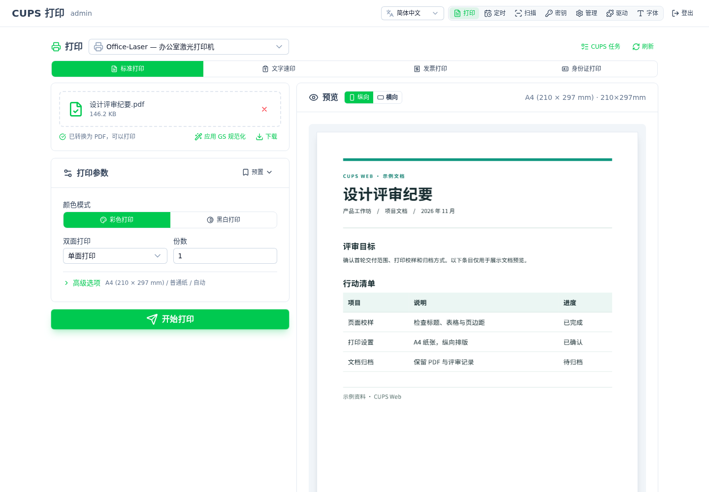
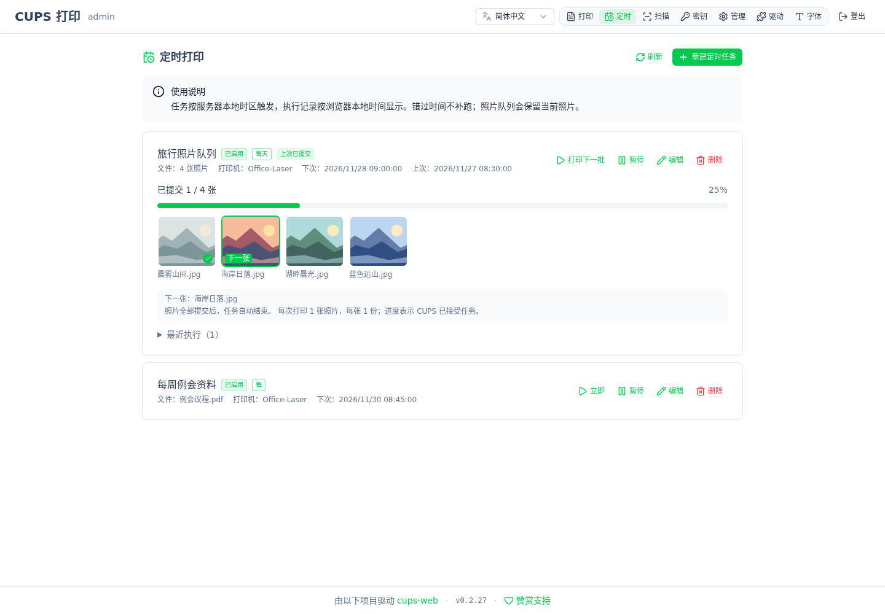
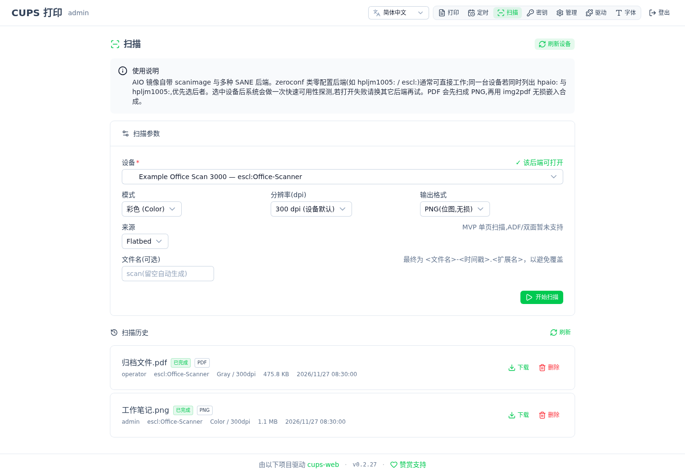
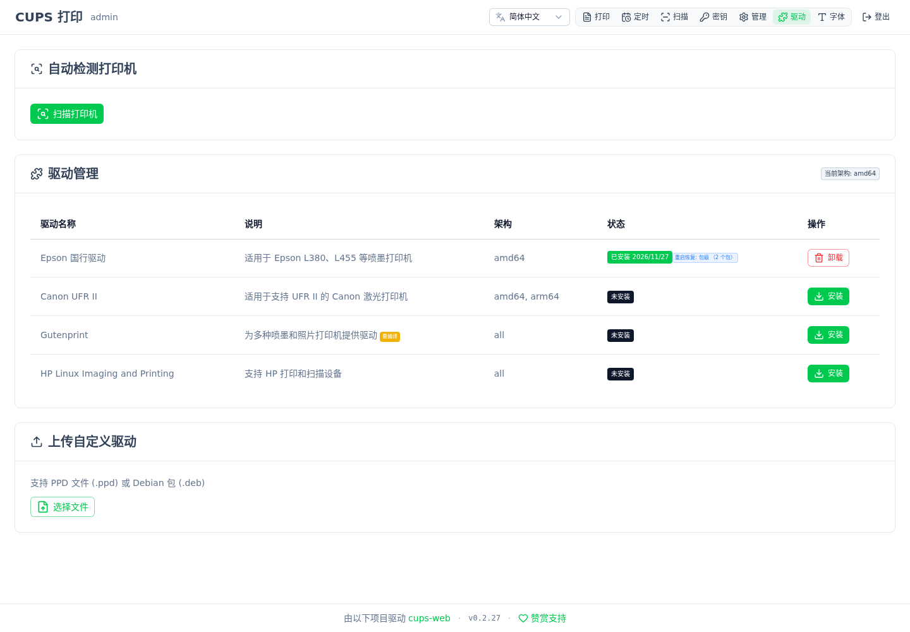

# 🖨️ CUPS Web — Web-Based Print Management

[简体中文](README.md) · **English**

[Project website and documentation](https://hanxi.cc/cups-web/en/)

<div align="center">

[](https://github.com/hanxi/cups-web/releases)
[](https://hub.docker.com/r/hanxi/cups-web)
[](https://hub.docker.com/r/hanxi/cups-web)
[](https://github.com/hanxi/cups-web/stargazers)
[](https://github.com/hanxi/cups-web/network/members)
[](https://github.com/hanxi/cups-web/issues)
[](https://github.com/hanxi/cups-web/commits)
[](https://github.com/hanxi/cups-web/releases)
[](LICENSE)

[](https://golang.org)
[](https://vuejs.org)
[](https://vitejs.dev)
[](https://ui.nuxt.com)
[](https://tailwindcss.com)
[](https://www.cups.org)
[](https://www.sqlite.org)

🏠 [GitHub](https://github.com/hanxi/cups-web) • 🐳 [Docker Hub](https://hub.docker.com/r/hanxi/cups-web) • 📖 [Developer Guide](AGENTS.en.md) • 💬 [WeChat Group](https://github.com/hanxi/cups-web/issues/36) • 💰 [Support the Project](https://afdian.com/a/imhanxi)

</div>

CUPS Web brings CUPS printing to your browser. Upload files, submit jobs remotely, manage multiple users, and track print history at home or in a small office.

## 📸 Screenshots

<div align="center">
<table>
  <tr>
    <td align="center"><a href="docs/screenshots/print-desktop.png"></a><br/><b>Print settings and PDF preview</b></td>
    <td align="center"><a href="docs/screenshots/scheduled-desktop.png"></a><br/><b>Scheduled photo queue</b></td>
  </tr>
  <tr>
    <td align="center"><a href="docs/screenshots/scan-desktop.png"></a><br/><b>Scan settings and history</b></td>
    <td align="center"><a href="docs/screenshots/drivers-desktop.png"></a><br/><b>Printer driver management</b></td>
  </tr>
</table>
</div>

[Browse all desktop, tablet, and mobile screenshots](docs/en/screenshots/README.md)

## ✨ Features

### Printing

- **Supported formats** include PDF, images (JPG/PNG/GIF/HEIC), Office documents (doc/docx/xls/xlsx/ppt/pptx), OFD, and plain text.
- **Automatic conversion** uses LibreOffice for Office documents and the bundled Java converter based on ofdrw for OFD. The server renders text and images to PDF.
- **Multi-image printing** combines selected images into one PDF.
- **Print options** include copies, duplex or simplex, color or monochrome, paper size including driver-supported borderless sizes, media type, quality, orientation, page range, scaling, and mirroring.
- **Live previews** show the PDF and paper orientation and provide an estimated page count.
- **Last settings and print presets** ([Issue #128](https://github.com/hanxi/cups-web/issues/128)). After a successful standard print job, the browser remembers the settings except the watermark text and page range. Under **Print settings → Presets**, save named sets of options to apply, rename, replace, or delete later. Account presets work across devices for signed-in users. Use **Restore defaults** to reset the form.
- **Scheduled photo queues**. Choose **Print photos in order** when creating a scheduled job. Upload JPG, PNG, or GIF files in bulk, reorder them by dragging or with the arrow controls, and share print settings across the queue. Daily, weekly, and monthly schedules submit the next batch of 1–100 photos, with one photo per run by default. Choose whether to stop or loop at the end. The task shows its progress, next photo, and execution history. You can pause, resume, or print the next batch early.

Schedules interpret the start date and run time in the server's local time zone. Each successful submission saves progress. A failed batch stops at the failing photo and resumes from it on the next run. Missed windows during downtime leave the photo sequence in place. **Print next batch** advances the next run and preserves a paused task's paused state. The database and upload directory retain photos and progress across container restarts. Deleting a task also removes its original images and thumbnails. Progress tracks CUPS acceptance. Confirm physical output at the printer. If the service stops during submission or the result is uncertain, the queue remains paused and reports that confirmation is required. Check the printer before resuming.

The print screen, reprint dialog, and scheduled jobs load driver options from the target queue. Use **Refresh options** to reload them. Borderless appears when the driver or IPP reports a matching specification. Image-to-PDF conversion removes the application's extra margins, although a different photo aspect ratio can still leave margins. Crop the photo first if needed. If loading fails, the interface reports the reason and keeps the current selection. [Printer options](docs/en/printer-options.md)

### Scanning ([Issue #111](https://github.com/hanxi/cups-web/issues/111))

The all-in-one (AIO) image includes `scanimage` and `libsane-hpaio`. All signed-in users can open **Scan**.

- **Single-page flatbed scanning** supports one capture per job. ADF batch scanning and duplex scanning are pending.
- **Output formats** include lossless PNG, smaller JPEG, and PDF. The PDF pipeline scans to PNG first and uses Ghostscript to handle SANE backends that differ in `--format=pdf` support.
- **Options** include Color, Gray, or Lineart mode, a resolution of 75–600 dpi, and Flatbed or ADF sources where the device reports support.
- **Background jobs and live logs**. Submission immediately returns a `jobId`. The page polls every 1.5 seconds and displays output from `scanimage` and `gs`. The hard timeout is five minutes.
- **Persistent history**. Scan files go to `SCAN_DIR`, mapped to `./.scans:/scans` in `docker-compose.yml`. Metadata goes to `scan_records`. Each regular user sees their own records. Administrators see all records.
- **Availability check**. `scanimage -L` may report multiple backends such as `hpaio:`, `hpljm1005:`, and `escl:` for one device. Some HP multifunction printers, including the M1005, return SANE's input/output error when opened through `hpaio:`. The UI checks each newly selected device once through `/api/scan/devices/probe`. If it cannot open the device, try `hpljm1005:` or `escl:`.
- **Discovery cache**. `scanimage -L` can take around 17 seconds as the SANE backends run in sequence. `SCAN_DEVICES_CACHE_TTL` defaults to `60s`. Use a longer value such as `24h` for fixed hardware. After connecting a different scanner, click **Refresh** to re-enumerate with `?force=1`.

> The container uses SANE's `scanimage`. HPLIP's `hp-scan` returned SANE I/O error code 9 even after starting D-Bus with `dbus-daemon --system --fork`. The `scanimage` path was verified on the same host and hardware, including an HP LaserJet M1005 MFP.
>
> During the original rollout, scan discovery was available in `hanxi/cups-web:dev` and from source via `make all` before the `master` and release image tags were refreshed.

### Native Chinese Printing and Font Management

Missing fonts can change the line breaks and layout of Chinese government documents and business files that use fonts such as FangSong_GB2312 and Founder XiaoBiaoSong, HeiTi, or KaiTi.

- **Mounted fonts and live refresh**. Put fonts in the host directory mapped to `/data/fonts`, normally `./.data/fonts`. Startup synchronizes them and patches the Ghostscript `cidfmap`. During operation, **Refresh font cache** reloads fonts without a container restart.
- **Font management in the web UI**. Administrators can open **Fonts** or `/#/fonts`. Upload `.ttf`, `.ttc`, and `.otf` files, search by name, or delete fonts. The SFNT Name table supplies the real family, weight, and TTC faces, so a file called `1.ttf` can still display as Arial.
- **Preflight for missing fonts**. Before converting a `.docx` or a PDF without embedded fonts, the service checks the required families against installed fonts. If a required font is missing and fallback is disabled, the API returns `422`. The warning dialog offers **Cancel**, **Allow fallback this time**, and **Always allow fallback** so you can decide before submission.

### Printer Drivers

The AIO image includes Debian's `printer-driver-all` and other common packages. You can install model-specific drivers on demand through the web UI or command line.

**Bundled drivers**

- `printer-driver-all` includes Debian drivers such as splix, c2050, m2300w, and ptouch
- `printer-driver-cups-pdf` provides a virtual PDF printer
- `printer-driver-escpr` supports common Epson ESC/P-R inkjet models
- `printer-driver-foo2zjs` supports ZjStream, Hiperc, and OAKT for some legacy HP, Konica, and Minolta laser printers
- `printer-driver-brlaser` supports older Brother laser printers
- `foomatic-db-compressed-ppds` and `openprinting-ppds` supply a broad PPD library
- `hplip`, `hpijs-ppds`, and `hp-ppd` support HP printers
- `ipp-usb` and CUPS driverless support discover IPP Everywhere, AirPrint, and Mopria devices

**Optional vendor drivers**

| Driver | Command name | Architectures | Example models |
| --- | --- | --- | --- |
| Canon UFR II | `canon-ufr2` | amd64 / arm64 | i-SENSYS LBP/MF, imageCLASS, imageRUNNER |
| Canon CAPT | `canon-capt` | All 🔧 | LBP2900 / LBP2900B |
| HP LaserJet 1020 firmware | `hp-laserjet1020` | All | LaserJet 1020 / 1020 Plus |
| HP foo2zjs firmware | `foo2zjs-firmware` | All 🔧 | LaserJet 1000/1005/1018/P1005/P1006/P1505 |
| Epson ESC/P-R 2 | `escpr2` | amd64 / armhf / arm64 | ET-18100, L8050, L8160, WF-7840 |
| Epson China-market driver | `epson-cn` | amd64 only | L380, L455 |
| Konica Minolta bizhub | `konica-bizhub` | amd64 / arm64 | bizhub 3000MF |
| Sharp PostScript | `sharp` | All | MX-C2622R and other PostScript printers |
| Gutenprint | `gutenprint` | amd64 / arm64 | Many older Epson, Canon, and HP models |

> 🔧 marks drivers built inside the container. A build can take several minutes or longer on small ARM systems. Packages that only need downloading and unpacking usually install in tens of seconds.
>
> Epson ESC/P-R 2 uses prebuilt packages on amd64 and armhf. On arm64 it builds from source and can take several minutes.
>
> The UI disables installation when the vendor lacks a binary for the current architecture and explains why.

### Driver Management in the Web UI

Sign in as an administrator and open **Drivers**.

- **Detection** scans USB and network printers and recommends a matching driver.
- **One-click setup** installs the driver, adds the printer to CUPS with `lpadmin`, and sets A4 as the default paper size.
- **Driver list** shows available drivers, installation status and date, and supported architectures. It also lets you install and remove drivers.
- **Custom drivers** accepts PPD files (`.ppd`) and Debian packages (`.deb`).
- **Persistence** snapshots installed driver files to `.drivers` and restores them when the container is rebuilt.

#### Background Installation

The API returns immediately and installs the driver in the background. A progress card polls every two seconds and shows build and installation logs.

- Canon CAPT, HP foo2zjs firmware, and Epson ESC/P-R 2 on arm64 can take several minutes or longer to compile. The rolling log shows that the task is still active.
- Keep the page open and let the job finish. A page refresh leaves the background installation running, but you can lose the live log in the UI. To follow it from a terminal, run `docker compose logs -f cups`.
- The background job times out after 30 minutes. The page waits up to 35 minutes.

#### One Driver Job at a Time

The apt and dpkg global lock permits one install, removal, or one-click setup at a time. The backend rejects a second driver job or a `.deb` upload while a driver job is active. Wait for it to finish before trying again.

#### Restore Uploaded PPD and Debian Packages

| Upload | After a container restart |
| --- | --- |
| `.ppd` | Restored from `.drivers` into `/usr/share/cups/model/custom` |
| `.deb` | Reinstalled with `dpkg -i` from `.drivers/custom-deb/packages/` |

Debian package scripts perform the actual installation. Archiving the full package lets startup run those scripts again when needed. An already-installed package at the same version or newer is skipped.

> Failed uploads retry at each startup and produce a warning. To stop retries for a particular package, remove its archived file under `./.drivers/custom-deb/packages/`.
>
> `dpkg` executes package installation scripts as **root in the container**. Limit administrator accounts to trusted users and upload packages only from trusted sources. Regular `user` accounts have no access to driver administration. Uploads log the uploader's username for auditing.
>
> Preserve `./.drivers` when rebuilding or backing up the deployment. Removing it or omitting the mount loses the snapshots for manually installed drivers.

CLI driver operations run synchronously:

```bash
# List available drivers
docker exec cups driver-list

# Install a driver
docker exec cups driver-install canon-ufr2

# List installed drivers
docker exec cups driver-list --installed

# Uninstall a driver
docker exec cups driver-remove canon-ufr2
```

### Users and Permissions

- **Roles** include `admin` and `user`.
- **Default administrator** `admin/admin` is created on first startup. The protected `admin` account cannot be removed or renamed.
- **Print history** can retain the file, page and copy counts, duplex and color settings, and job status.

### Administration

- **Users** can be created, edited, or deleted. Administrators can change roles and contact details.
- **Print history** can be filtered by username and date range.
- **Retention** removes expired print records and their files. The cleanup runs hourly.
- **Fonts** show real system and custom font family names from the SFNT Name table. Administrators can upload or delete fonts, refresh the cache, and decide whether missing fonts block printing.

### Security

- **Session authentication** uses Gorilla `securecookie` with encryption and signing. The generated keys persist in the database.
- **CSRF protection** validates `X-CSRF-Token` on requests that modify state. GET, HEAD, and OPTIONS are exempt.
- **Passwords** are hashed with bcrypt.

### API Keys ([Issue #113](https://github.com/hanxi/cups-web/issues/113))

API keys let integrations such as WeChat, Feishu, or DingTalk bots and home automation scripts call print APIs directly.

- Open **API keys** in the signed-in navigation or go to `/#/api-keys`.
- Give each key a label and an expiration of 7, 30, 90, or 365 days, or choose no expiration. The full key appears once at creation. Save it securely. You can revoke keys later.
- Send `Authorization: Bearer <key>` or `X-API-Key: <key>` for API authentication. The key inherits its owner's role. Standard `user` keys cannot call admin APIs.
- The `guest` account cannot create or use keys. Only browser sessions can create or revoke keys.

```bash
# List printers
curl -H "Authorization: Bearer cw_XXXXXXXX" https://your-host/api/printers
```

## 🛠️ Technology Stack

- **Backend** uses Go 1.26, Gorilla Mux, and SQLite through the pure Go `modernc.org/sqlite` driver.
- **Print protocol** uses IPP through [OpenPrinting/goipp](https://github.com/OpenPrinting/goipp).
- **Frontend** uses Vue 3, Vite 7, [Nuxt UI v4](https://ui.nuxt.com/), Tailwind CSS v4, and Vue Router in hash mode.
- **Document conversion** uses LibreOffice for Office files and [ofdrw](https://github.com/ofdrw/ofdrw) on Java 21 for OFD.
- **Print service** uses [CUPS](https://www.cups.org/) 2.4.x built from source over the apt version.

## 🚀 Quick Start

Choose a deployment:

- [Docker Deployment](#docker-deployment) runs CUPS and the web app together and is recommended for a new installation.
- [Web-Only Image](#web-only-image-external-cups) connects to an existing CUPS server or a separate CUPS image.
- [Standalone Binary](#standalone-binary) runs the web app on a host with CUPS already configured.

---

## Docker Deployment

### Prerequisites

- Docker and Docker Compose
- A USB printer if you are connecting a printer directly

### 1. Create `docker-compose.yml`

```yaml
services:
  cups:
    image: hanxi/cups-web:latest
    container_name: cups
    user: root
    hostname: CUPS
    # Host networking allows LAN multicast for mDNS/DNS-SD discovery and
    # AirPrint advertisements (issue #107).
    network_mode: host
    security_opt:
      - apparmor:unconfined
    environment:
      - CUPSADMIN=${CUPSADMIN:-print}
      - CUPSPASSWORD=${CUPSPASSWORD:-print}
      - TZ=${TZ:-Asia/Shanghai}
      # With host networking, the web app listens directly on host port 1180.
      - LISTEN_ADDR=${LISTEN_ADDR:-:1180}
      # Scans go to the ./.scans:/scans volume below.
      - SCAN_DIR=${SCAN_DIR:-/scans}
    volumes:
      - ./.etc:/etc/cups
      - ./.data:/data
      - ./.uploads:/uploads
      - ./.drivers:/opt/cups-drivers/data
      - ./.scans:/scans
      - /dev/bus/usb:/dev/bus/usb
      - /run/udev:/run/udev:ro
    device_cgroup_rules:
      - 'c 189:* rmw'
    # libusb may need full sysfs access to enumerate USB printers on ARM and
    # embedded platforms (issue #110). Omit this on x86 if it is unnecessary.
    privileged: true
    restart: unless-stopped
```

You can also download the repository's Compose file:

```bash
wget https://raw.githubusercontent.com/hanxi/cups-web/master/docker-compose.yml
```

> `latest` is the latest tagged release. `dev` is built on pushes to `master`. To try it, change `image: hanxi/cups-web:latest` to `image: hanxi/cups-web:dev`.

### 2. Set Environment Variables (Optional)

Create `.env` next to the Compose file:

```bash
CUPSADMIN=print
CUPSPASSWORD=your_cups_password
TZ=Asia/Shanghai
```

### 3. Start the Service

```bash
docker compose up -d
```

### 4. Install a Printer Driver (If Needed)

Most printers work with the bundled drivers. Install a model-specific driver when needed.

1. Open <http://localhost:1180> and sign in with `admin/admin`.
2. Open **Drivers** as an administrator.
3. Click **Scan printers** to detect connected printers.
4. Select **Install and add** for the detected printer.

> The installation job runs in the background and streams its log. A source build can take several minutes or longer. Keep the page open while it runs. The service accepts one driver job at a time. [Driver management in the web UI](#driver-management-in-the-web-ui)

You can also install the driver from the command line:

```bash
docker exec cups driver-install canon-ufr2
```

### 5. Configure the Printer

If the detection tool did not add the printer, open <http://localhost:631>, sign in with the CUPS administrator account, and add it manually.

For a printer connected to a Windows computer, add its SMB share in CUPS. The guide covers a dedicated account, driver setup, and publishing only the web port. [Add a Windows shared printer](docs/en/windows-shared-printer.md)

> After adding a printer, set it to **Shared** in CUPS so the web app can discover it.

### 6. Open the Web App

Open <http://localhost:1180>. The initial username is `admin` and the initial password is `admin`. Change the password after signing in.

> [tzishue/cloud-printer](https://hub.docker.com/r/tzishue/cloud-printer) is an alternative CUPS image with additional model-specific drivers.

---

## Web-Only Image (External CUPS)

Use the web-only image when you already run CUPS. It provides the web interface, multiple users, print records, and Office, OFD, and PDF conversion. It connects to CUPS over TCP via `CUPS_HOST` or over a Unix socket via `CUPS_SOCKET_PATH`.

| Tags | Contents |
| --- | --- |
| `hanxi/cups-web:latest` / `dev` / `vX.Y.Z` | Combined CUPS and web app |
| `hanxi/cups-web:latest-web` / `dev-web` / `vX.Y.Z-web` | Web app for an external CUPS server |

Install drivers and share the printers in external CUPS first. Verify that the web container can reach its IPP service. External CUPS handles printer configuration, driver installation, and AirPrint. The web-only image omits local USB scanning and driver-management tools and runs without a USB mount or privileged mode.

For TCP, add the CUPS address to `.env`:

```dotenv
CUPS_HOST=192.168.1.100:631
```

Start the service using the repository's [docker-compose.web.yml](docker-compose.web.yml):

```bash
docker compose -f docker-compose.web.yml up -d
```

Open <http://localhost:1180>, sign in with `admin/admin`, and change the password. The database and uploads persist in `./.data` and `./.uploads`.

Use a host reachable from the web container or a CUPS service in the same Docker network, in `host:port` format. Inside the web container, `localhost` refers to that container. When using a separate CUPS container, attach both services to the same Docker network and follow the CUPS image's setup instructions.

### Connect Through a Unix Socket

On one host, you can share the CUPS runtime directory and connect over its socket. Enable the listener in the external `cupsd.conf`:

```conf
Listen /var/run/cups/cups.sock
```

When connecting to CUPS on the host, use the repository's [socket Compose override](docker-compose.web.socket.yml):

```bash
docker compose -f docker-compose.web.yml -f docker-compose.web.socket.yml up -d
```

The override mounts the host's `/var/run/cups` read-only in the web container and sets `CUPS_SOCKET_PATH=/var/run/cups/cups.sock`. If CUPS uses a different runtime directory on the host, set `CUPS_SOCKET_DIR` in `.env`. The socket configuration takes precedence over `CUPS_HOST`.

For two containers, mount the same runtime volume in both services. Adapt this example to your service and volume names:

```yaml
services:
  cupsd:
    volumes:
      - cups_runtime:/var/run/cups
  web:
    image: hanxi/cups-web:latest-web
    ports:
      - "1180:8080"
    environment:
      CUPS_SOCKET_PATH: /var/run/cups/cups.sock
    volumes:
      - cups_runtime:/var/run/cups:ro
      - ./.data:/data
      - ./.uploads:/uploads
    restart: unless-stopped
volumes:
  cups_runtime:
```

Mount the whole directory so the web container follows socket recreation when CUPS restarts. The web process still needs permission to traverse the directory and connect to the socket. Unix permissions apply to read-only mounts as usual.

`CUPS_SOCKET_PATH` must be an absolute path visible inside the web process's environment. After it is set, a missing socket, permission error, or connection failure aborts the request and logs the cause. The web app keeps printer URIs in HTTP or IPP format and uses `localhost:631` as the placeholder host. Network communication uses the Unix socket. Historical print records and schedules use the same connection. If you switch CUPS servers, preserve the names of the queues they reference.

Socket mode uses the configured socket as its fixed destination. `PRINTER_HOST_ALLOWLIST` and `PRINTER_BLOCK_PRIVATE` apply to TCP only. External CUPS continues to enforce its access policy and manage drivers, queues, and AirPrint.

Build the web-only image locally if you need it before a new tag is available:

```bash
make docker-build-web
# Set the image in docker-compose.web.yml to cups-web:web, then start it.
```

---

## Standalone Binary

Use the binary when you already operate a CUPS server. Install and configure CUPS and your printer drivers separately.

- **Driver installation**. The AIO image supplies `driver-install` and the persistence directory `/opt/cups-drivers`. Without those files, the **Drivers** page displays drivers as uninstalled and disables installation. Direct API calls to install them fail with `no such file or directory`. Use the host package manager, such as `apt install printer-driver-*`, or the CUPS administration UI.
- **Printer discovery** needs `lpinfo` from the `cups-client` package. The scan action reports `failed to detect printers` when it is missing.
- **Office, OFD, and PDF normalization** require system installations of LibreOffice, Java, and Ghostscript as applicable.

### 1. Download the Binary

Find a build for your platform in [GitHub Releases](https://github.com/hanxi/cups-web/releases).

| Platform | Architecture | Filename |
| --- | --- | --- |
| Linux | amd64 | `cups-web-linux-amd64` |
| Linux | arm64 | `cups-web-linux-arm64` |
| Linux | armv7 | `cups-web-linux-armv7` |
| Linux | loong64 | `cups-web-linux-loong64` |
| macOS | amd64 | `cups-web-darwin-amd64` |
| macOS | arm64 | `cups-web-darwin-arm64` |
| Windows | amd64 | `cups-web-windows-amd64.exe` |

```bash
wget https://github.com/hanxi/cups-web/releases/latest/download/cups-web-linux-amd64
chmod +x cups-web-linux-amd64
```

### 2. Configure and Run

```bash
export CUPS_HOST=localhost:631
export DB_PATH=./data/cups-web.db
export UPLOAD_DIR=./uploads
export LISTEN_ADDR=:8080

./cups-web-linux-amd64
```

The command-line flag overrides the environment:

```bash
./cups-web-linux-amd64 -addr :8080
```

> The Docker image bundles OFD printing support. To enable it with the standalone binary, install a Java runtime (the image uses Java 21) and place `ofd-converter.jar` at `/ofd-converter.jar`, or configure the converter path.

### 3. Open the Web App

Open <http://localhost:8080> and sign in with `admin/admin`.

---

## ⚙️ Configuration

### Environment Variables

| Variable | Description | Default |
| --- | --- | --- |
| `LISTEN_ADDR` | Web listen address | `:8080` |
| `DB_PATH` | SQLite database path | `data/cups-web.db` |
| `UPLOAD_DIR` | Directory for uploaded files | `uploads` |
| `CUPS_HOST` | CUPS address | `localhost` |
| `CUPS_SOCKET_PATH` | Absolute path to the CUPS Unix socket. Takes precedence over `CUPS_HOST` when set | Empty (TCP) |
| `CUPSADMIN` | CUPS administrator username | `print` |
| `CUPSPASSWORD` | CUPS administrator password | `print` |
| `TZ` | Time zone | `Asia/Shanghai` |
| `COOKIE_SECURE` | Session and CSRF cookie `Secure` flag. `auto` follows the request protocol. `true` always sets the flag. `false` always omits it | `auto` |
| `TRUSTED_ORIGINS` | Comma-separated allowed origins such as `https://print.example.com`. Set when the origin check rejects a known deployment | Empty |
| `PRINTER_HOST_ALLOWLIST` | Comma-separated printer URI host allowlist for SSRF protection | Empty (no allowlist) |
| `PRINTER_BLOCK_PRIVATE` | Reject printer URIs that resolve to private addresses when `true` | `false` |
| `OFD_CONVERTER_JAR` | OFD-to-PDF converter JAR path | `/ofd-converter.jar` |
| `SCAN_DIR` | Scan output directory, backed by `./.scans` in Compose | `scans` |
| `SCAN_DEVICES_CACHE_TTL` | Scanner discovery cache lifetime as a Go duration, such as `60s` or `24h`. `scanimage -L` can take around 17 seconds. A longer lifetime keeps page transitions fast, and **Refresh** sends `?force=1` to rediscover connected devices. Values of zero or less disable caching | `60s` |
| `FONTS_DIR` | Custom font directory. The container uses `/data/fonts`, backed by `./.data/fonts` | `/data/fonts` in the container or `data/fonts` on the host |

> `.env.example` lists `CUPSADMIN`, `CUPSPASSWORD`, and `TZ` for AIO and commented examples for `CUPS_HOST` and `CUPS_SOCKET_PATH` for web-only deployments. AIO can start with the built-in defaults. A web-only deployment needs the external CUPS address or socket.
>
> `DB_PATH` and `UPLOAD_DIR` default to relative paths. The image's working directory is `/`, so they resolve to `/data/cups-web.db` and `/uploads/`, as configured in the volume mappings.
>
> AIO runs CUPS and the web app in one container, so `CUPS_HOST` defaults to `localhost`. For TCP in a web-only deployment, use the external host or `host:port`. The default CUPS port is `631`. See [Connect Through a Unix Socket](#connect-through-a-unix-socket) for the socket setup.
>
> `COOKIE_SECURE=auto` sets `Secure` for direct HTTPS (`r.TLS`) and when the reverse proxy sends `X-Forwarded-Proto: https`. Plain HTTP on the LAN continues to work. If the proxy reports HTTPS while the client uses HTTP, the browser can lose the session immediately after login. Set `COOKIE_SECURE=false` for that HTTP deployment.
>
> `TRUSTED_ORIGINS` is usually unnecessary. Behind a reverse proxy, the origin check can use `X-Forwarded-Host`. [Reverse proxy guide](docs/en/reverse-proxy.md)

### Command-Line Flags

| Flag | Description |
| --- | --- |
| `-addr` | Listen address. Overrides `LISTEN_ADDR` |

### Default Ports

- CUPS uses `631` for IPP and administration. With host networking in Docker, CUPS listens on port `631` of the host. [Issue #107](https://github.com/hanxi/cups-web/issues/107)
- The standalone web binary listens on `8080`. For AIO, `LISTEN_ADDR` in `docker-compose.yml` defaults to `:1180`, matching the earlier bridge deployment.

### Persistent Data

The default Compose mounts are listed below.

| Host path | Container path | Data |
| --- | --- | --- |
| `./.etc` | `/etc/cups` | CUPS configuration, printer queues, and PPDs |
| `./.data` | `/data` | SQLite database and custom fonts in `./.data/fonts` |
| `./.uploads` | `/uploads` | Original files and converted PDFs |
| `./.drivers` | `/opt/cups-drivers/data` | Manually installed driver snapshots. Removing this volume loses those drivers on rebuild |
| `./.scans` | `/scans` | Scan files. `SCAN_DIR` chooses the directory. Metadata lives in `scan_records` in `.data/cups-web.db` |

The following mounts support USB printer discovery and hot-plugging.

| Host path | Container path | Purpose |
| --- | --- | --- |
| `/dev/bus/usb` | `/dev/bus/usb` | Mount the directory so new device nodes become visible when the printer is switched on |
| `/run/udev` | `/run/udev` (read-only) | Exposes device attributes to libusb. Omit when the host has no such directory |

> When upgrading, remove the old `/run/dbus/system_bus_socket` bind mount. It came from the original AirPrint setup and can prevent container D-Bus and Avahi from starting on a host without Avahi. With host networking, the Avahi instance in the container handles discovery and announcements on the LAN. [Issue #94](https://github.com/hanxi/cups-web/issues/94) · [Issue #107](https://github.com/hanxi/cups-web/issues/107)

### Other Compose Options

| Option | Purpose |
| --- | --- |
| `network_mode: host` | Carries mDNS/DNS-SD multicast on UDP `5353` for LAN discovery and AirPrint. CUPS binds directly to host port `631`, and `LISTEN_ADDR` sets the web port. Host Avahi can compete for `5353` and cannot publish for CUPS in the container because the instances use separate D-Bus buses. Stop host Avahi if it conflicts. [Issue #107](https://github.com/hanxi/cups-web/issues/107) |
| `hostname: CUPS` | Avahi announces AirPrint and IPP Everywhere as `CUPS.local` |
| `LISTEN_ADDR=:1180` | In host mode, binds the web app to port `1180`, preserving bookmarks and reverse proxy configurations |
| `user: root` | Lets the container run cupsd, `lpadmin`, and `dpkg` and modify driver directories such as `/usr/lib/cups` and `/usr/share/ppd` |
| `security_opt: [apparmor:unconfined]` | Avoids AppArmor denials affecting printing and LibreOffice or OFD converter processes in environments such as Proxmox VE LXC. [Issue #91](https://github.com/hanxi/cups-web/issues/91) |
| `device_cgroup_rules: ['c 189:* rmw']` | Gives the container access to USB character devices (major 189). [Issue #81](https://github.com/hanxi/cups-web/issues/81) |
| `privileged: true` | Enables full sysfs access for libusb on ARM or embedded platforms, such as Raspberry Pi or Amlogic devices with Armbian. On x86, the device cgroup rule usually suffices. [Issue #110](https://github.com/hanxi/cups-web/issues/110) |

---

## 📖 Usage Guide

### Supported Formats

| Type | Extensions | Processing |
| --- | --- | --- |
| PDF | `.pdf` | Prints directly |
| Images | `.jpg` `.jpeg` `.png` `.gif` `.heic` | Converts to PDF and can combine multiple images |
| Office | `.doc` `.docx` `.xls` `.xlsx` `.ppt` `.pptx` | Converts with LibreOffice |
| OFD | `.ofd` | Converts with ofdrw |
| Text | `.txt` `.md` `.html` | Renders to PDF on the server |

### Print a Document

1. Select a printer.
2. Upload a file or a group of images.
3. Preview the PDF and adjust the print settings.
4. Submit the job. CUPS Web saves the record and sends the job to CUPS.

### Administrator Features

- **User management** creates, edits, and deletes users. The default `admin` account keeps its name and role.
- **Print records** can be filtered by user and date. Administrators can download original files.
- **System settings** control the number of days to keep records. `0` keeps them indefinitely.
- **Driver management** discovers printers, installs and removes drivers, and uploads custom PPDs and Debian packages. One background task at a time runs with live logs.

---

## 🔧 Advanced Configuration

### Reverse Proxy and HTTPS

Use a reverse proxy such as Nginx for external access.

```nginx
server {
    listen 443 ssl;
    server_name example.com;

    ssl_certificate     /path/to/cert.pem;
    ssl_certificate_key /path/to/key.pem;

    # Allow print uploads up to 200 MB.
    client_max_body_size 200m;

    location / {
        proxy_pass http://localhost:1180;

        proxy_set_header Host              $host;
        proxy_set_header X-Real-IP         $remote_addr;
        proxy_set_header X-Forwarded-For   $proxy_add_x_forwarded_for;
        proxy_set_header X-Forwarded-Proto $scheme;
        proxy_set_header X-Forwarded-Host  $host;

        # Allow long conversions and driver installations.
        proxy_read_timeout    300s;
        proxy_send_timeout    300s;
        proxy_request_buffering off;
    }
}
```

> Keep all five `proxy_set_header` directives. Dropping `Host` or `X-Forwarded-Host` can cause the origin check to reject login and produce an incorrect-password message. Dropping `X-Forwarded-Proto` can prevent HTTPS cookies from receiving the `Secure` flag. [Issue #99](https://github.com/hanxi/cups-web/issues/99)
>
> The guide covers troubleshooting, Caddy and Traefik, and serving under a URL subpath. [Reverse proxy guide](docs/en/reverse-proxy.md)

### Change the Ports

The default Compose configuration uses host networking. [Issue #107](https://github.com/hanxi/cups-web/issues/107)

- **Web**. Change `LISTEN_ADDR` in Compose or `.env`. The default is `:1180`.

  ```dotenv
  LISTEN_ADDR=:YOUR_WEB_PORT
  ```

- **CUPS**. Edit the listener in `./.etc/cupsd.conf` and restart the container if you must change port `631`. IPP and AirPrint clients commonly expect `631`.
- **Bridge networking**. For deployments without printer discovery or AirPrint multicast, remove `network_mode: host` and `LISTEN_ADDR` and publish ports with `ports: ["YOUR_CUPS_PORT:631", "YOUR_WEB_PORT:8080"]`. For SMB printing with only the web port published, see [Add a Windows shared printer](docs/en/windows-shared-printer.md).

### Back Up Data

```bash
cp ./.data/cups-web.db /backup/location/
tar -czf uploads-backup.tar.gz ./.uploads/
tar -czf cups-config-backup.tar.gz ./.etc/
tar -czf drivers-backup.tar.gz ./.drivers/
```

> Include `.drivers` because it contains the snapshots of manually installed third-party drivers. Snapshots are architecture-specific. Restoring an amd64 snapshot on arm64 prompts you to remove and reinstall the driver for arm64.

---

## ❓ FAQ

### I Forgot the Administrator Password

Deleting the database and restarting resets the administrator to `admin/admin` and **erases all application data in the database**.

```bash
docker compose down
rm ./.data/cups-web.db
docker compose up -d
```

### A Printer Does Not Appear in the Web App

1. Check that CUPS lists the printer at <http://localhost:631>.
2. Confirm that the printer is set to **Shared**.
3. Restart the container with `docker compose restart cups`.

### A USB Printer Does Not Appear After It Is Powered On

The current `docker-compose.yml` supports hot-plugging by mounting `/dev/bus/usb` and using `device_cgroup_rules` with `privileged: true`. On x86 the cgroup rule is usually sufficient, so you can omit privileged mode if the hardware works with it disabled.

### AirPrint or LAN Printer Discovery Fails

AirPrint advertisements and CUPS discovery of `dnssd://xxx._ipp._tcp.local` use mDNS multicast on UDP `5353`. Docker bridge networking does not pass this LAN multicast between the host and container by default. The default Compose configuration uses `network_mode: host` so Avahi in the container can advertise and discover printers on the LAN. [Issue #107](https://github.com/hanxi/cups-web/issues/107)

1. Use the current Compose setup with `network_mode: host`, without `ports:` or a `/run/dbus/system_bus_socket` mount. The old D-Bus bind mount could prevent the container's D-Bus or Avahi from starting on hosts without Avahi. [Issue #94](https://github.com/hanxi/cups-web/issues/94)
2. Inspect startup warnings with `docker logs cups | grep -i 'dbus\|avahi'`.
3. If the host runs Avahi, check for a conflict on UDP `5353`. Its separate D-Bus bus prevents it from advertising for the instance in the container. In case of a conflict, stop host Avahi with `sudo systemctl disable --now avahi-daemon` and restart the container.
4. Check your router or access point for multicast filtering. Retest using the same access point.

Check Avahi inside the container:

```bash
# List LAN services such as _ipp._tcp or _pdl-datastream._tcp.
docker exec cups avahi-browse -art
# Resolve the .local name through libnss-mdns.
docker exec cups getent hosts CUPS.local
```

### Installed Drivers Disappear

Confirm the driver persistence mount in `docker-compose.yml`:

```yaml
volumes:
  - ./.drivers:/opt/cups-drivers/data
```

CUPS Web restores drivers from `.drivers` on container recreation. Deleting that directory removes the snapshots for all manually installed drivers. Reinstall those drivers from **Drivers**.

Uploaded `.ppd` files are restored individually. An uploaded `.deb` is archived and reinstalled through `dpkg -i` unless the same or a newer version is already present. The UI lists installed packages.

### Driver Installation Is Still Running

The installation runs in the background. The progress card updates every two seconds and shows live logs.

- Canon CAPT, HP foo2zjs firmware, and arm64 Epson ESC/P-R 2 compile from source. A build can take more than ten minutes on small ARM hosts.
- Let the current job finish while the log is advancing. Refreshing the page can clear the live log, and additional attempts will be rejected.
- Follow the log separately with `docker compose logs -f cups`.
- Background jobs time out after 30 minutes. The page waits up to 35 minutes and shows an error if the operation times out.

### A Driver Job Is Already Running

The apt and dpkg global lock allows only one installation, removal, or one-click setup job at a time. Debian package uploads are blocked during the job. Retry when the current job finishes.

### The Install Button Is Disabled

Hover over the button to see the reason.

- **Unsupported architecture**. Some vendors only publish binaries for specific platforms. The Epson China-market driver is amd64 only, Canon UFR II supports amd64 and arm64, and Gutenprint has no armhf package in the project. Try a bundled or driverless/IPP Everywhere driver that supports your printer.
- **Missing installation script**. A standalone binary or a trimmed image may omit the driver scripts from the standard image.

### Printing Fails in Proxmox VE LXC With an AppArmor Denial

Use `security_opt: [apparmor:unconfined]` in the service. The current Compose file includes it. Enable **Nesting** and **Keyctl** for the Proxmox LXC container.

### Office or OFD Conversion Fails

- The conversion timeout is **60 seconds**. Large or complex documents can exceed it.
- Verify the original file opens correctly. If needed, export it to PDF on your computer and upload that copy.
- Check `docker compose logs -f cups`.

### Chinese Documents Have Layout Problems or Report Missing Fonts

CUPS Web bundles open-source Source Han Serif and Source Han Sans. Documents that use commercial fonts such as FangSong_GB2312, KaiTi_GB2312, or Founder XiaoBiaoSong can show wrong line breaks, overlapping characters, or layout shifts when those fonts are missing. With preflight blocking enabled, the service stops submission and lists missing families.

1. **Upload in the web UI**. As an administrator, open **Fonts** (`/#/fonts`) and upload the appropriate `.ttf`, `.otf`, or `.ttc` files. CUPS Web reads the real family names and reloads the fonts immediately.
2. **Use the Docker volume for bulk setup**. Place fonts in `./.data/fonts` on the host, mapped to `/data/fonts` in the container. Refresh the font cache or restart the container to synchronize files and patch Ghostscript font mappings.
3. **Allow substitution for a temporary print**. Enable font fallback in **Fonts** to use the bundled Source Han fonts when originals are unavailable.

### View Logs

```bash
docker compose logs -f cups
```

---

## 🤝 Contributing

Issues and pull requests are welcome. [Developer Guide](AGENTS.en.md)

## 📈 Star History

<div align="center">

[](https://star-history.dera.page/#hanxi/cups-web&Date)

Star the repository to help people discover it.

</div>

## 💖 Support the Project

### ⭐ Star the Project

Star the project on GitHub to help others find it.

### 💰 Sponsor the Project

- [Afdian](https://afdian.com/a/imhanxi)
- Scan the QR code to leave a tip.

<p align="center">
  
</p>

Thank you for supporting the project.

## 📄 License

CUPS Web is distributed under the MIT License. [LICENSE](LICENSE)
